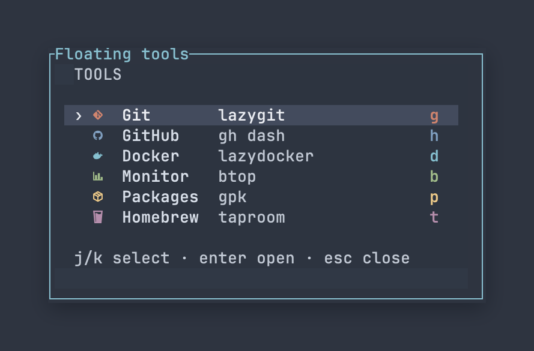

# Herdr Floating Tools

A compact keyboard launcher for terminal tools. Open a small menu, select a tool,
and run it in a larger popup using **Herdr's reported pane directory**, unless
that tool specifies `cwd`. The existing pane and its running program stay untouched.



Actual Herdr/Ghostty screenshot, cropped to the menu with a presentation margin.

This is a community plugin, not an official Herdr-maintained component.

## Requirements

- Herdr 0.9.5+ and Python 3.11+ with `curses` (macOS or Linux).
- Your chosen tools installed on the Herdr server's PATH.
- A Nerd Font for the example icons; omit `icon` to use plain text.
- Windows is not supported. Terminal glyph widths can vary by font; simple icons
  work best, rather than multi-codepoint emoji sequences.

## Quick start

### 1. Install

```sh
herdr plugin install DS-argus/herdr-floating-tools
```

No manual clone or build step is required. For development, use the
[linked checkout](#development-and-tests) instructions instead.

Installation registers the action but **does not edit your keybindings** or
install lazygit, btop, or other tools.

### 2. Add a shortcut

Merge into `~/.config/herdr/config.toml` (or your custom config). Keep your other
settings. Replace any existing Prefix+f binding rather than adding a duplicate.

```toml
[[keys.command]]
key = "prefix+f"
type = "plugin_action"
command = "ds-argus.floating-tools.open"
description = "Floating tools"
```

### 3. Validate and reload

```sh
herdr config check && herdr server reload-config
```

### 4. Open the menu

Press your configured Prefix, then `f`. Use `j/k` or arrow keys and Enter,
or press a tool's shortcut directly. `q`, Escape and Ctrl+C cancel the menu.
When items do not fit, the menu uses discrete pages; PageUp/PageDown also work.
Items do not scroll when they all fit. Tool popups receive their own native keys:
`q` and Escape do not universally close every tool.

## Configuration

```sh
herdr plugin config-dir ds-argus.floating-tools
```

Create `config.toml` in the directory printed above. This is separate from
Herdr's main config and is not automatically created. Without it, the plugin
uses the six entries in [config.example.toml](config.example.toml). User entries
replace that list; they are not merged with defaults. Changes apply next time
you open the menu. An already-open menu keeps its original configuration snapshot.

```toml
[[tools]]
id = "git"
key = "g"
name = "Git"
icon = "󰊢"
color = "#d08770"
description = "lazygit"
command = ["lazygit"]
width = "80%"
height = "80%"
close_on_exit = true

[[tools]]
id = "tests"
key = "t"
name = "Cargo tests"
command = ["cargo", "test"]
cwd = "."
width = "90%"
height = "70%"
close_on_exit = false
```

| Field | Required | Behavior |
| --- | --- | --- |
| `id` | Yes | Unique ID: letters, digits, `_`, `-`; up to 64 characters |
| `key` | Yes | Unique lowercase letter or digit; `j/k/q` are reserved |
| `name` | Yes | Display name; up to 100 characters |
| `icon` | No | Optional icon, up to 8 characters; omitted icon is blank |
| `color` | No | Icon/shortcut color in `#RRGGBB`; otherwise inherited accent |
| `description` | No | Secondary display text, up to 200 characters; never inferred from command |
| `command` | Yes | Nonempty argument array, not a shell command string |
| `cwd` | No | Default: captured `focused_pane_cwd`; explicit absolute, `~/path`, or relative override |
| `width` | No | Tool popup width; default `"80%"` |
| `height` | No | Tool popup height; default `"80%"` |
| `close_on_exit` | No | Default `true`; `false` shows exit status and waits for Enter |

Width/height accept integer cells (1–1000) or percentages (`"1%"`–`"100%"`).
Herdr enforces its own minimums and fits popups to the available area. These
settings apply to the **tool**, not the menu. Menu dimensions grow with item
count and display-name width (up to 100 columns), with pagination when clamped.
There are at most 64 tools and a 32 KB serialized configuration limit.

The menu uses compact rows and optional per-item colors. When no entries have
icons, the icon column is removed. Long names and descriptions are clipped to
the actual width. See the color configuration below.

## Reproduce the screenshot

- [examples/nord.toml](examples/nord.toml): the six tools, icons, descriptions,
  item colors and selection colors used in the screenshot.
- [examples/herdr-nord.toml](examples/herdr-nord.toml): the matching Herdr theme
  settings. Merge into Herdr's main config without duplicating existing tables.

No development checkout is required. To use the screenshot configuration,
download the example and review it before replacing your current configuration:

```sh
curl -fL https://raw.githubusercontent.com/DS-argus/herdr-floating-tools/main/examples/nord.toml -o /tmp/herdr-floating-nord.toml
```

After reviewing the file (back up an existing config first):

```sh
config_dir="$(herdr plugin config-dir ds-argus.floating-tools)"
cp /tmp/herdr-floating-nord.toml "$config_dir/config.toml"
```

From a development checkout, `examples/nord.toml` is the same example.

Then apply the Herdr theme snippet and run:

```sh
herdr config check && herdr server reload-config
```

Open the menu again. The screenshot uses Ghostty with a Nerd Font; exact font,
size and antialiasing are terminal settings, not plugin options. Its outside
presentation margin/shadow was added to the cropped image and is not a UI option.

## Colors and descriptions

```toml
[theme]
selected_bg = "#434c5e"
selected_fg = "#eceff4"
```

Each tool accepts optional `color = "#d08770"` for its icon and shortcut,
and `description = "lazygit"` for the secondary column. Colors use `#RRGGBB`.
Descriptions are independent of commands: omitted descriptions remain blank,
and arguments are never automatically exposed. Long descriptions are truncated
with `…` using terminal-cell width. The shortcut column remains fixed; the
name has priority over the description on narrow terminals.

Selection foreground applies to the name and description, while the icon and
shortcut keep their item color. All cells share the same selection background.

Theme inheritance reads `HERDR_CONFIG_PATH` or the standard Herdr config path.
It supports the static Nord palette and explicit hex/reset `theme.custom`
tokens (`panel_bg`, `text`, `subtext0`, `accent`, `selection_bg`). Plugin
`selected_bg` and `selected_fg` take precedence. An item without `color` uses
the inherited accent. Other named palettes use terminal defaults plus explicit
custom tokens; automatic light/dark switching is not resolved. This is not full
Herdr palette synchronization. Colors are exact when curses can allocate RGB
colors, otherwise approximated to the terminal palette.

## Working directory: what the default means

By default, the launcher captures **`focused_pane_cwd` from Herdr's plugin
invocation context when the menu opens**. This is the pane `cwd` reported by
Herdr, not a permanently fixed Space/project root and not `foreground_cwd`.
It may differ from the working directory of the foreground program, including
an agent or file manager. The launcher does not infer a project root, inspect
Herdr's saved session files, or substitute the foreground process directory.

For example, if Herdr reports `focused_pane_cwd = "/project"` while the
foreground process is in `/project/subdir`, a tool without `cwd` starts in
`/project`. This does not guarantee that `/project` remains the Space's original
creation directory: the value comes from Herdr at invocation time.

A tool's explicit `cwd` takes precedence:

- Omitted: use the captured `focused_pane_cwd`.
- `cwd = "."`: also use that captured path; it does not refresh the live path.
- `cwd = "subdir"`: resolve relative to the captured path.
- `cwd = "~/projects/app"` or an absolute path: use that directory explicitly.

The resolved directory must exist. If you need a known project root regardless
of pane/process directory changes, set the tool's `cwd` explicitly. There is no
Space-root mapping or execution-path display in the menu.

## Execution and safety

- The source directory is captured from Herdr's invocation context, not the
  plugin checkout. The action requires a valid local pane directory.
- Relative executable paths such as `./scripts/check` resolve in the tool's cwd.
  `~/` is expanded in cwd and the executable path; other arguments are literal.
- No shell interpolation, globbing, variable substitution or command chaining.
  Complex operations belong in a trusted script explicitly listed in `command`.
- Tools are not sandboxed: they run with your user permissions. Never put
  secrets in command arguments, and review configuration before using it.
- Missing executables and invalid settings produce an English notification and
  an error log. Missing tools remain visible; they are not silently removed.
- `close_on_exit=false` waits only after the process exits. It does not keep the
  process alive after the popup is closed, nor make a persistent agent session.
- This is not a process supervisor. Programs that daemonize themselves have
  their own lifecycles. Prefer normal panes for persistent servers or agents.
- Popup closure and terminal signals follow Herdr's normal PTY behavior.
- Existing Herdr popups/modals may prevent opening the menu. Only the brief
  menu-to-tool teardown race is retried, with a bounded deadline.
- Error notifications follow Herdr's global delivery and position settings.

## Development and tests

```sh
gh repo clone DS-argus/herdr-floating-tools
cd herdr-floating-tools
herdr plugin link "$PWD"
python3 -m unittest discover -v
```

The opt-in real Herdr test uses an isolated HOME/server and a harmless fixture
command. It verifies cancel/reopen, actual plugin-action context, original cwd
(including spaces and Korean characters), literal arguments, nonzero process
exit status, and retained output:

```sh
RUN_HERDR_INTEGRATION=1 python3 -m unittest discover -v
```

macOS is locally integration-tested. CI runs unit tests on macOS and Ubuntu;
a real Linux Herdr session is not claimed tested unless that opt-in suite is run.

## Update and remove

GitHub-managed installation:

```sh
herdr plugin update ds-argus.floating-tools
```

Linked checkout: `git pull --ff-only`, then relink after manifest changes.
To remove, delete the shortcut and run:

```sh
herdr plugin uninstall ds-argus.floating-tools
herdr config check && herdr server reload-config
```

Use `plugin unlink` for a development checkout. Herdr may retain the plugin's
configuration; remove it separately only if no longer needed.
